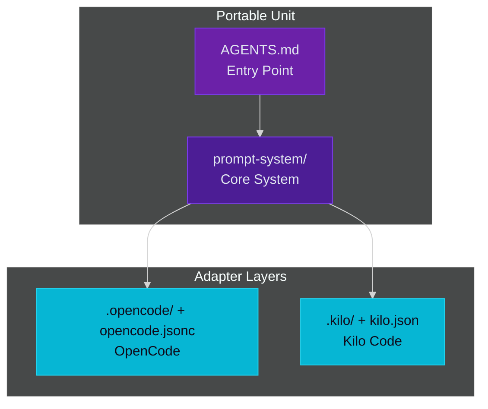

# SYSTEM OVERVIEW

> **Architecture, load order, file map** — The Baba prompt system structure.

---

## Architecture Layers



| Layer | File(s) | Purpose |
|---|---|---|
| Entry | [AGENTS.md](AGENTS.md) | Portable entry point, MCP tiers, system pointer |
| Orchestrator | [prompt-system/00-system.md](prompt-system/00-system.md) | Phase model, routing, hard guards, load order |
| Triggers | [prompt-system/11-triggers.md](prompt-system/11-triggers.md) | Canonical trigger catalog, T-01 to T-24 |
| Personas | [prompt-system/01-personas.md](prompt-system/01-personas.md) | 8 personas + handoff contract + session flow |
| Decisions | [prompt-system/02-decision-prompts.md](prompt-system/02-decision-prompts.md) | Decision format, rendering rule, auto-triggers |
| Output | [prompt-system/03-output-and-state.md](prompt-system/03-output-and-state.md) | Phase templates, dual-section output, session state schema |
| Rubrics | [prompt-system/04-rubrics.md](prompt-system/04-rubrics.md) | H1-H38, S1-S25, L1-L10 review rubrics |
| Logical detail | [prompt-system/04b-rubrics-logical.md](prompt-system/04b-rubrics-logical.md) | L1-L10 detailed rubrics |
| Style | [prompt-system/05-impl-style.md](prompt-system/05-impl-style.md) | Implementation style, stack variants, conventions |
| Patch | [prompt-system/06-misc.md](prompt-system/06-misc.md) | PATCH protocol, commit/push gate, leftover handling |
| Protocols | [prompt-system/07-protocols.md](prompt-system/07-protocols.md) | Cross-cutting protocols (artifacts, pre-commit, drift, etc.) |
| Gate | [prompt-system/08-plan-actual-gate.md](prompt-system/08-plan-actual-gate.md) | Plan-versus-actual verification protocol |
| Design | [prompt-system/09-design-guidelines.md](prompt-system/09-design-guidelines.md) | Design guidelines owned by BabaDesigner |
| Doc style | [prompt-system/10-doc-style.md](prompt-system/10-doc-style.md) | Documentation style: naming, TOC, mermaid, lint |
| Rules | [prompt-system/rules.md](prompt-system/rules.md) | H13-H38 mechanical detection/enforcement |

The layer model itself -- what a layer *is*, and how a review moves through the
system -- is in [ARCHITECTURE.md](ARCHITECTURE.md). This table is only the file
inventory of the deployed unit.

---

## File Map

```text
.
├── AGENTS.md              # Entry point
├── README.md              # Navigation hub
├── CHANGELOG.md           # Generated changelog (v1.0.0 forward)
├── CHANGELOG_ARCHIVE.md   # Hand-written changelog (through v1.0.0)
├── STYLE_POLICY.md        # Project style policy
├── ARCHITECTURE.md        # Layer model, review path, portable vs adapter
├── SYSTEM_OVERVIEW.md     # This file
├── AGENTS_USAGE.md        # How to use and deploy the system
├── CONFORMANCE.md         # Protocol invariants
├── GLOSSARY.md            # Central terminology reference
├── SPEC.md                # Living spec and registry (moved to project-management/specs/)
├── TASKS.md               # Build tasks mapped to spec sections (moved to project-management/specs/)
├── QUICKSTART.md          # 5-minute onboarding
├── LICENSE                # ISC
├── prompt-system/         # The deployed unit
│   ├── 00-system.md       # Orchestrator
│   ├── 11-triggers.md     # Canonical trigger catalog
│   ├── 01-personas.md     # Personas
│   ├── 02-decision-prompts.md  # Decisions
│   ├── 03-output-and-state.md  # Templates
│   ├── 04-rubrics.md      # Rubrics
│   ├── 04b-rubrics-logical.md  # L1-L10 detail
│   ├── 05-impl-style.md   # Style core
│   ├── 06-misc.md         # PATCH protocol
│   ├── 07-protocols.md    # Protocols
│   ├── 08-plan-actual-gate.md  # Plan-actual gate
│   ├── 09-design-guidelines.md  # Designer input
│   ├── 10-doc-style.md    # Documentation style
│   ├── rules.md           # H13-H38 rules
│   ├── personas.json      # Persona registry, drives adapter generation
│   ├── stacks/            # Per-language style sections
│   ├── scripts/           # Integrity suites, locks, reference-pool tooling
│   └── templates/         # LaTeX template for the arxiv-paper command
├── user-guide/            # Getting started, personas, phases, modes, troubleshooting
├── project-management/    # Roadmaps, sprints, Trello integration, config
├── adapters/              # Adapter templates (source of truth)
│   ├── opencode/agents/     # OpenCode agent templates
│   ├── opencode/commands/   # OpenCode command templates
│   ├── claude/agents/       # Claude Code agent templates
│   ├── claude/skills/       # Claude Code skill templates
│   ├── kilo/agent/          # Kilo Code agent templates
│   └── kilo/command/        # Kilo Code command templates
├── opencode-memory-mw/    # Memory middleware research workspace (paper + simulation)
├── scripts/               # Bootstrap helpers (playwright, uvx, plugin verify)
├── opencode.jsonc         # OpenCode-native config
├── .opencode/             # Generated: agents, commands, plugins, packages, lib, tests
├── .kilo/                 # Generated: agents, commands, kilo.json
├── .mcp.json              # Generated MCP server config (both platforms)
├── sync.ps1               # Interactive propagation to target projects
├── generate-adapters.ps1  # Generates .opencode/, .claude/, and .kilo/ from adapters/
├── pre-commit.ps1         # The commit gate
└── targets.json.example   # Template for sync.ps1 targets
```

---

## Documentation Structure

| Location | Purpose |
|---|---|
| [prompt-system/](prompt-system/) | The deployed unit -- protocol, rubrics, style, templates |
| [user-guide/](user-guide/) | Getting started, personas, phases, modes, troubleshooting |
| [project-management/](project-management/) | Roadmaps, sprints, Trello integration, backend config |
| [GLOSSARY.md](GLOSSARY.md) | Central terminology reference |
| [CONFORMANCE.md](CONFORMANCE.md) | Protocol invariants verified before each phase transition |
| [ARCHITECTURE.md](ARCHITECTURE.md) | Layer model and review path |
| [opencode-memory-mw/](opencode-memory-mw/) | Memory middleware research workspace, not part of the deployed unit |

---

## Key Cross-References

| Need | Document |
|---|---|
| Phase flow | [user-guide/PHASES.md](user-guide/PHASES.md) |
| Execution modes | [user-guide/EXECUTION_MODES.md](user-guide/EXECUTION_MODES.md) |
| Personas | [user-guide/PERSONAS.md](user-guide/PERSONAS.md) |
| Getting started | [user-guide/GETTING_STARTED.md](user-guide/GETTING_STARTED.md) |
| Troubleshooting | [user-guide/TROUBLESHOOTING.md](user-guide/TROUBLESHOOTING.md) |
| Rubrics | [prompt-system/04-rubrics.md](prompt-system/04-rubrics.md) |
| Rules (H13-H38) | [prompt-system/rules.md](prompt-system/rules.md) |
| Style defaults | [prompt-system/05-impl-style.md](prompt-system/05-impl-style.md) |
| Protocols | [prompt-system/07-protocols.md](prompt-system/07-protocols.md) |
| PATCH protocol | [prompt-system/06-misc.md](prompt-system/06-misc.md) |
| Plan-versus-actual gate | [prompt-system/08-plan-actual-gate.md](prompt-system/08-plan-actual-gate.md) |
| Session context | [prompt-system/03-output-and-state.md](prompt-system/03-output-and-state.md) |
| OpenCode setup | [AGENTS_USAGE.md](AGENTS_USAGE.md) |
| Kilo Code setup | [KILO_USAGE.md](KILO_USAGE.md) |

---

> **Note**: `AGENTS.md` deploys only itself plus `prompt-system/`. Every other
> file here is repository documentation and is never copied to a target project.
