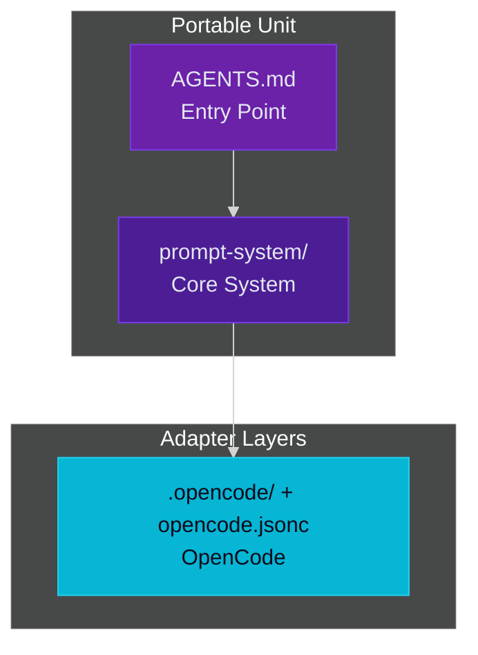

# SYSTEM OVERVIEW

> **Architecture, load order, file map** — The Baba prompt system structure.

---

## Architecture Layers



| Layer | File(s) | Purpose |
|---|---|---|
| Entry | `AGENTS.md` | Portable entry point, MCP tiers, system pointer |
| Orchestrator | `prompt-system/00-system.md` | Phase model, routing, hard guards, load order |
| Personas | `prompt-system/01-personas.md` | 6 personas + handoff contract + session flow |
| Decisions | `prompt-system/02-decision-prompts.md` | Decision format, rendering rule, auto-triggers |
| Output | `prompt-system/03-output-and-state.md` | Phase templates, dual-section output, session state schema |
| Rubrics | `prompt-system/04-rubrics.md` | H1-H38, S1-S20, L1-L10 review rubrics |
| Style | `prompt-system/05-impl-style.md` | Implementation style, stack variants, conventions |
| Patch | `prompt-system/06-misc.md` | PATCH protocol, commit/push gate, leftover handling |
| Protocols | `prompt-system/07-protocols.md` | Cross-cutting protocols (artifacts, pre-commit, drift, etc.) |
| Gate | `prompt-system/08-plan-actual-gate.md` | Plan-vs-actual verification protocol |
| Rules | `prompt-system/rules.md` | H13-H38 mechanical detection/enforcement |

---

## File Map

```text
.
├── AGENTS.md              # Entry point
├── README.md              # Navigation hub
├── CHANGELOG.md           # Version history
├── STYLE_POLICY.md        # Project style policy
├── ARCHITECTURE.md        # Layer model, review path, portable vs adapter
├── SYSTEM_OVERVIEW.md     # This file
├── AGENTS_USAGE.md        # How to use and deploy the system
├── CONFORMANCE.md         # Protocol invariants
├── GLOSSARY.md            # Central terminology reference
├── QUICKSTART.md          # 5-minute onboarding
├── prompt-system/         # The deployed unit
│   ├── 00-system.md       # Orchestrator
│   ├── 11-triggers.md     # Canonical trigger catalog
│   ├── 01-personas.md     # Personas
│   ├── 02-decision-prompts.md  # Decisions
│   ├── 03-output-and-state.md  # Templates
│   ├── 04-rubrics.md      # Rubrics
│   ├── 04b-rubrics-logical.md  # L1-L10 detail
│   ├── 05-impl-style.md   # Style core
│   ├── 06-misc.md         # PATCH protocol
│   ├── 07-protocols.md    # Protocols
│   ├── 08-plan-actual-gate.md  # Plan-actual gate
│   ├── 09-design-guidelines.md  # Designer input
│   ├── 10-doc-style.md    # Documentation style
│   ├── rules.md           # H13-H38 rules
│   ├── stacks/            # Per-language style sections
│   └── scripts/           # Integrity suites, reference-pool tooling
├── user-guide/            # Getting started, personas, phases, modes, troubleshooting
├── project-management/    # Roadmaps, sprints, Trello integration
├── adapters/              # Adapter templates (source of truth)
├── opencode.jsonc
├── .opencode/             # Generated OpenCode adapters
├── .claude/               # Generated Claude Code adapters
└── sync.ps1
```

---

## Documentation Structure

| Location | Purpose |
|---|---|
| `prompt-system/` | The deployed unit -- protocol, rubrics, style, templates |
| `user-guide/` | Getting started, personas, phases, modes, troubleshooting |
| `project-management/` | Roadmaps, sprints, Trello integration |
| `GLOSSARY.md` | Central terminology reference |
| `CONFORMANCE.md` | Protocol invariants verified before each phase transition |

---

## Key Cross-References

| Need | Document |
|---|---|
| Phase flow | `user-guide/PHASES.md` |
| Execution modes | `user-guide/EXECUTION_MODES.md` |
| Rubrics | `prompt-system/04-rubrics.md` |
| Rules (H13-H38) | `prompt-system/rules.md` |
| Style defaults | `prompt-system/05-impl-style.md` |
| Protocols | `prompt-system/07-protocols.md` |
| PATCH protocol | `prompt-system/06-misc.md` |
| Plan-actual gate | `prompt-system/08-plan-actual-gate.md` |
| Session context | `prompt-system/03-output-and-state.md` |
| OpenCode setup | `user-guide/OPENCODE.md` |

---

> **Note**: `AGENTS.md` deploys only itself plus `prompt-system/`. Every other
> file here is repository documentation and is never copied to a target project.
